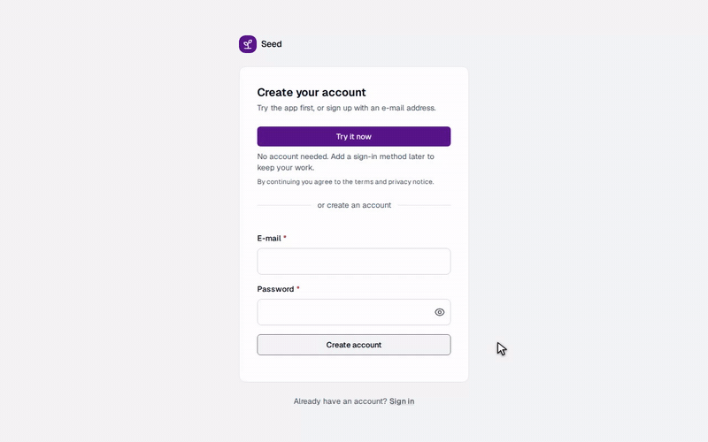

<div align="center">

# template

**A SaaS starting point on web standards: sign-up with a second factor, groups, billing, an API, a
web app, a worker and Postgres. Work in progress.**

[](https://ci.antonshubin.com/repos/11)
[](LICENSE)

```sh
gh repo create my-product --template spy4x/template --private --clone
```



[Architecture](docs/architecture.md) · [ADR 001](docs/decisions/001-deno-platform-template.md) ·
[ADR 002](docs/decisions/002-realtime-transport-and-sync.md) ·
[ADR 003](docs/decisions/003-swappable-transport-and-local-data.md) · [Stack](docs/stack.md) ·
[Deno policy](docs/deno-policy.md) · [Adding an aggregate](docs/aggregates.md) · [Billing](docs/billing.md) ·
[Handoff](docs/handoff.md)

</div>

Create your repository from it, fill in the env file, and you start with a product that already
has accounts, a second factor, tenancy and a place for background work. A new user signs up and
gets an account, a session and a first group in one database transaction. Groups are the only
tenancy boundary, so the same membership checks and roles cover a person's own data and
shared workspaces.

It exists because every SaaS MVP needs the same groundwork before its first feature. The reusable
parts live here and in the published [`@spy4x/*`](https://jsr.io/@spy4x) packages; product rules
stay out.

**Status:** work in progress, moving to the target architecture in
[ADR 001](docs/decisions/001-deno-platform-template.md). Sign-up, sign-in with TOTP, groups with
members, roles, invitations and ownership transfer, billing per member, notes (the reference
aggregate), the outbox worker and the public website work today, and the SPA works offline
([docs/offline.md](docs/offline.md)). Details in
[docs/architecture.md](docs/architecture.md#migration-status); what is not built yet is listed on
the [open issues](https://github.com/spy4x/template/issues). The live demo runs at
https://app.seedsaas.com, its website at https://seedsaas.com.

## Quick start

```sh
cp infra/envs/.env.example infra/envs/.env
```

Before going on, fill in the secrets in `infra/envs/.env` (`KV_PASSWORD` is the Valkey password;
Valkey and the API both refuse to start without it, `openssl rand -hex 24` makes one). It runs on
Docker; to use Podman, set `CONTAINER_PROVIDER=podman` (`proxy:start` and `proxy:stop` still call
Docker).

```sh
deno task vapid-key:create   # web push keys → infra/configs/vapid.json
deno task proxy:start        # Traefik
deno task dev                # Postgres, Valkey, API, worker, SPA and the monitoring
```

Compose joins every service that Traefik routes to a Docker network named `proxy`. `proxy:start` and
`dev` create it when it is missing (`deno task proxy:network` does only that) and leave an existing one
alone, so a fresh machine needs no extra command.

Then open `http://<DOMAIN>` from the env file: http://app.localhost with the values in
`infra/envs/.env.example`.

Metrics and logs go to VictoriaMetrics and VictoriaLogs, with Grafana on top at
`http://localhost:3000` ([Admin consoles](#admin-consoles)). `COMPOSE_PROFILES=monitoring` in the
env file runs those three in this project; without it, `VM_REMOTE_WRITE_URL` and `VLOGS_URL` send
the same metrics and logs to a monitoring server you already have.
[docs/stack.md](docs/stack.md#monitoring) describes both modes.
node-exporter and cAdvisor watch the whole host, so they are off by default: add `host-monitoring`
to `COMPOSE_PROFILES` to start them too.

To try the MPA in Compose, see "The SPA and the MPA" below. Stop the proxy with
`deno task proxy:stop`. Compose applies pending migrations on every start, in the one-shot
`migrate` service that the API and the worker wait for; a failed migration stops the start. To apply
them from the host instead, for an API run outside Compose, use the values from your `.env` and the
port Compose publishes:

```sh
DB_HOST=127.0.0.1 DB_PORT=5432 DB_USER=<user> DB_PASS=<password> DB_NAME=<name> deno task db:migrate
```

To start again from an empty development database, run `ENV=dev deno task db:reset` with the same
values (plus the seed's `AUTH_PEPPER` and `SEED_PASSWORD`). It drops the database, migrates it and
seeds it, after you confirm; `--yes` skips the question. It refuses unless `ENV=dev`, `DB_HOST` is
`localhost`, `127.0.0.1` or `db`, and `DB_NAME` differs from the one in `infra/envs/.env.prod`. A
missing or unreadable `.env.prod` also refuses; on a machine without one, add `--no-prod-check`.
A missing `DB_PORT`, `DB_USER` or `DB_PASS`, or a missing or invalid `AUTH_PEPPER` or
`SEED_PASSWORD`, refuses too, before anything is dropped.

To add a demo user who signs in as `demo@example.com` and owns the group `Demo team`, run
`ENV=dev deno task db:seed` with the same values plus `AUTH_PEPPER` (the API's) and `SEED_PASSWORD`
(the demo user's password, 8 to 50 characters). It runs only with `ENV=dev`. The demo user is an
administrator, so they can also sign in to the [admin app](#the-admin-app). Run again, it finds
the user, makes them an administrator again if their role changed, and changes nothing else; when
it cannot create the user, it says so and exits with 1.

## What a fresh project looks like

| Light                                                                                                                                                                                                                                                                                                   | Dark                                                                                                                                                                                                                                                                                                  |
| ------------------------------------------------------------------------------------------------------------------------------------------------------------------------------------------------------------------------------------------------------------------------------------------------------- | ----------------------------------------------------------------------------------------------------------------------------------------------------------------------------------------------------------------------------------------------------------------------------------------------------- |
|                                              |                                              |
|  |  |

The screenshots and the GIF use a throw-away database and a made-up user;
[`docs/screenshots/record.ts`](docs/screenshots/record.ts) records them again from a running app.

<details>
<summary>How the parts fit together</summary>


</details>

## Why template

- **Tenancy from day one.** Every user gets a group at sign-up; every group uses the same IDs,
  membership checks and roles, from viewer to owner. A group can be renamed, deleted and, for 30
  days, restored, and a person always keeps at least one.
- **Auth that is done.** Sign-up, sign-in, sessions and an authenticator-app second factor, with
  PBKDF2-SHA-256 password hashes. Web push subscriptions are built in too.
- **Offline-first SPA.** The SPA keeps the last notes and groups in IndexedDB (the shared data cache), opens with no
  network, and queues note writes with their idempotency keys. It sends them on reconnect and
  shows a stale write as a conflict to settle, never as a silent overwrite. The layer sits in one
  folder, so a product that does not want it deletes the folder and keeps an online SPA:
  [docs/offline.md](docs/offline.md).
- **Mailing lists.** Visitors subscribe at `/subscribe` with double opt-in, and every list mail
  carries a one-click unsubscribe. The worker signs the links with `SUBSCRIBERS_SECRET` and sends
  the confirm, welcome and issue mail: [docs/architecture.md](docs/architecture.md#mail-subscriptions).
- **CQRS with an outbox.** Commands, queries and events go through one bus. Creating a shared
  group writes its event to `outbox_events`, and the worker drains that table.
- **Safe API defaults.** Every mutation must come from the web app's own origin, and group lists
  page with HMAC-signed cursors.
- **Built on web standards.** Hono handlers take a Fetch `Request` and return a `Response`;
  password hashes and cursor signatures use Web Crypto; live updates travel over a standard
  WebSocket; everything is an ES module. The servers run on Deno 2 in Docker on any Linux host you
  control, and the clients run in any modern browser.
- **Operations included.** Docker Compose for development and single-node production: Traefik,
  Postgres, Valkey, VictoriaMetrics, VictoriaLogs and Grafana.

**Use it if** you are starting a multi-user web product and want auth, tenancy and operations
settled before the first feature. **Skip it if** you deploy to serverless functions rather than a server
you run.

## The SPA and the MPA

The template ships two web apps over the same API, with different jobs.

- **The SPA** (`apps/spa`, Preact and Vite) is the product. Everything a signed-in person does
  happens there: sign-up and sign-in, notes, groups, billing, the profile. People see each other's
  changes live over a WebSocket ([ADR 002](docs/decisions/002-realtime-transport-and-sync.md)), and
  it works offline ([docs/offline.md](docs/offline.md)). Compose serves it at `DOMAIN`.
- **The MPA** (`apps/mpa`, Fresh) is the product's public website: the home page, pricing read
  from the `PLANS` catalog, privacy and terms pages to adapt, `robots.txt`, `sitemap.xml` and the
  newsletter. Every page is rendered on the server and works with JavaScript turned off. It has
  no session; its sign-in and sign-up links open the SPA at `DOMAIN`.

The MPA calls the API over HTTP from the server, only for the newsletter, and never touches the
database itself. It needs `ENV` and `DOMAIN` (the same values as the API), its own host
`MPA_DOMAIN`, and `API_URL`, the address the MPA's server reaches the API at, such as
`http://<PROJECT>-api:8000` (Compose sets it); it refuses to start without any of them. To deploy it, set
`COMPOSE_PROFILES=mpa` in the env file (join it with other profiles by commas) and `MPA_DOMAIN` to
the website's own host, then run `deno task deploy` as usual: Compose builds the `mpa` service from
`apps/mpa/dockerfile.prod` and serves it at `MPA_DOMAIN`, next to the SPA at `DOMAIN`. The API
accepts a form only from `http(s)://DOMAIN`, so the MPA, after refusing any post that does not come
from its own pages, presents its posts to the API with `DOMAIN`'s origin. `MPA_DOMAIN` needs a DNS
record pointing at the server; Traefik gets its certificate as for `DOMAIN`. The API and the worker
read `MPA_DOMAIN` too: when it is set, the newsletter's mailed confirm and unsubscribe links open
the website's pages, which work without JavaScript, so set it only together with the profile.
Without it the links open the SPA. Without the profile nothing about the deploy changes. The MPA's
end-to-end test runs in CI on every pull
request, and locally with `e2e/mpa/run.sh` against a running Postgres and Valkey (see the header
of that script).

## The admin app

The admin app (`apps/admin`, Preact and Vite) is the operator area: people who run the product
find a person by address or name, filter by role and by blocked state, and open their page with
their sign-in methods, sessions, groups and audit trail. From there they block or unblock the
person, or end all their sessions. A block refuses every way in (password, Google, GitHub and API
tokens), ends the person's sessions and closes their open pages. Each action is confirmed in a
dialog, asks for no password, and writes an audit event naming the operator.
Nobody acts on themselves or on someone whose role is theirs or higher.

It runs on a host of its own, `ADMIN_DOMAIN`, so its session cookie belongs to that host alone. It
signs in with a password and a code only; Google and GitHub are not offered there. The API answers
the operator area (`/api/admin`) on that host only, and there only the operator area and sign-in.
A person below operator gets 404 from every operator route; the app's own check only says so.

Roles are `viewer` (everyone, by default), `operator`, `supervisor` and `administrator`; operator
and above open the admin app. To give someone a role, run
`deno task user:role <address> <role>` with the database variables set, such as
`deno task compose exec worker deno task user:role ada@example.com operator` on the server. It
finds the person by the address they sign in with and exits with 1 when nobody does. A change
writes an audit row on the person naming the script (`cli:user-role`). In the admin app, an
administrator can give a role below their own; an administrator is made only with the script.

To deploy it, add `admin` to `COMPOSE_PROFILES` in the env file and set `ADMIN_DOMAIN` to the
app's host, such as `admin.example.com`, then run `deno task deploy`. Compose builds the `admin`
service from `apps/admin/dockerfile.prod`, serves it at `ADMIN_DOMAIN` and sends that host's `/api`
to the API. `ADMIN_DOMAIN` needs a DNS record pointing at the server; Traefik gets its certificate.
In development, with the profile on, Compose serves it at `http://admin.localhost`, the
`ADMIN_DOMAIN` that `infra/envs/.env.example` sets.

## Production certificates

The production routers ask Traefik for certificates from the resolver named by
`TRAEFIK_CERT_RESOLVER` (default `myresolver`). `infra/compose/compose.proxy.yml` defines that
resolver: Let's Encrypt, HTTP challenge on port 80, certificates stored in
`.volumes/traefik/letsencrypt/acme.json`, expiry notices to `TRAEFIK_ACME_EMAIL`. Point `DOMAIN` at
the server and run `deno task proxy:start` there.

Plain `http://<DOMAIN>` (and `http://<MPA_DOMAIN>` with the `mpa` profile) answers a permanent
redirect to HTTPS. Other hosts can answer a permanent redirect to the same path on `MPA_DOMAIN`:
set `MPA_REDIRECT_RULE` to a Traefik rule, such as ``MPA_REDIRECT_RULE=Host(`www.example.com`)``.

The proxy serves nothing of its own but `/ping`: Traefik's dashboard and API are
off, because they list every router and backend address of every project behind the proxy.

**A server deployed before these changes needs three things once**, and its next deploy does
more than usual:

1. A server that runs Podman needs `CONTAINER_PROVIDER=podman` in its env file. Without that line
   the deploy used to run Podman and now runs Docker: it fails at "Starting the app" and the old
   containers stay up. Any other value than `docker` or `podman` is refused.
2. Run `deno task proxy:start` on it: `deno task deploy` restarts the app's containers but never
   the proxy, so the proxy that is already running keeps serving its dashboard at
   `proxy.<DOMAIN>` until then.
3. The next deploy publishes Grafana (with the `monitoring` profile) on `127.0.0.1:3000`. When
   something on the server that is not this project
   already listens on a port the project publishes, the deploy stops at "Starting the app" before
   any container is created, stopped or started: it names the port and the variable to change
   (`GRAFANA_HOST_PORT`), and what ran before still runs. Set that
   variable in the env file to a free `127.0.0.1:<port>` and deploy again
   ([Admin consoles](#admin-consoles)).

That deploy also recreates the project's network, which no longer has a fixed subnet. Compose
would start the containers it does not recreate on the new network without their service names
(`db`, `kv`), so the deploy sees the change coming (a dry run names the network), builds the
images, removes every container of the project and that network, and creates them all again:
expect a short outage of everything, the database included, not the usual restart of the app
alone. Data is not touched: it lives in `.volumes`. The base image is now named
`<PROJECT>/deno-base`; the old `app/deno-base` image stays on the server until you remove it
(`docker image rm app/deno-base:<version>`).

Every deploy starts the product first (the database, Valkey, the migration, the API, the worker,
the SPA, and the website with the `mpa` profile), then everything else. When a monitoring
container cannot start, the product already runs on the new version; the deploy still
fails, and its last lines name the services that are not up. A check that cannot be made (Compose
answers in a form the script does not read, as `podman-compose` may) is skipped, and the deploy
runs as one `compose up`, as it did before.

`deno task deploy [env file]` reads the server from the env file (`infra/envs/.env.prod` unless you
name another): `SSH_TO_SERVER`, `PATH_ON_SERVER` and, when Deno is not on the server's `PATH`,
`DENO_ON_SERVER`. `infra/envs/.env.example` lists them with every other name. The copy replaces
every server file that differs from your checkout, one edited on the server or newer there too, and
deletes the ones your checkout no longer has; env files and the web push keys are never touched. So
deploying an older commit is a full rollback of the code. It does not roll back the database or
Valkey: before rolling back, read traps 10 and 11 in [docs/handoff.md](docs/handoff.md).

**A server that ran Postgres 16 moves its data once.** The Compose file runs Postgres 18, which
keeps its data in a directory of its own, so the first deploy of this version stops at "Starting
the app" with a message that says why, and the old containers keep serving. Run
`deno task db:upgrade-18` on the server to move the data and finish the deploy:
[docs/postgres-18-upgrade.md](docs/postgres-18-upgrade.md) has the steps, the outage to expect and
the way back.

`deno task deploy` needs no manual step on a new server: it creates `infra/configs/vapid.json`
(the web push keys) there when the file is missing, readable by its owner only. It never sends the
key from your machine and never replaces one that exists. It stops before sending anything when a
password or secret in the env file equals one that `infra/envs/.env.example` prints (those values
are public), or when one that the example file sets is empty or missing, and names each such
variable. It reads the example file for that, so keep the file. Router, service and middleware names
carry `${PROJECT}`, so projects with different `PROJECT` values can share one Traefik. Postgres and
Valkey stay on `127.0.0.1`. Every image has a pinned version, except the nginx base of the SPA and
admin images (`nginx-unprivileged:stable-alpine`).

The template usually deploys behind a Traefik that several projects share. If that Traefik already
defines a resolver, do not start the proxy compose file: set `TRAEFIK_CERT_RESOLVER` to the name it
defines. If that Traefik defines none, copy the three `--certificatesresolvers.*` flags from
`compose.proxy.yml` into its command.

## Sign in with Google and GitHub

Both are off until you set their credentials: the sign-in and sign-up pages then show a "Continue
with …" link for each provider that is on, and the profile gets a "Sign-in methods" card. A
provider is on only when both of its variables are set in the env file.

| Provider | Where to register                                                         | Variables                                  | Callback URL to register                    |
| -------- | ------------------------------------------------------------------------- | ------------------------------------------ | ------------------------------------------- |
| Google   | Google Cloud console, "APIs & Services", "Credentials", "OAuth client ID" | `GOOGLE_CLIENT_ID`, `GOOGLE_CLIENT_SECRET` | `https://<DOMAIN>/api/auth/google/callback` |
| GitHub   | GitHub, "Settings", "Developer settings", "OAuth Apps", "New OAuth App"   | `GITHUB_CLIENT_ID`, `GITHUB_CLIENT_SECRET` | `https://<DOMAIN>/api/auth/github/callback` |

For Google choose the application type "Web application"; the scopes asked for are `openid` and
`email`. GitHub is asked for `read:user` and `user:email`. On your own machine the callback is
`http://app.localhost/api/auth/<provider>/callback`; register it as a second callback URL (Google)
or in a second OAuth App (GitHub allows one callback per app).

What a person gets:

- Someone the provider already signs in here is signed in. An account with an authenticator app is
  still asked for its code.
- Someone new is asked "Create a new account?" first, and nothing is created until they answer.
  The question waits 10 minutes; "I already have an account" creates nothing.
- When an account here already uses that address with a password but never confirmed it, the
  question says so first: creating the new account locks the old one (its password stops working),
  because the provider has proven who owns the address. The old account gets an audit row.
- A provider account joins an existing account by its e-mail address only when both sides have
  verified that address. An address the provider has not verified never links: that person is
  asked whether to create a new account, like anyone unknown.
- On the profile, a person links and unlinks providers. A provider account links whatever its
  e-mail address, and linking never changes another person's confirmed account; one that already
  signs in to another account here is refused, and the page says so. The last way into an account
  cannot be unlinked, and unlinking a method signs out the devices that signed in with it.
  Unlinking asks for the password, or for a provider sign-in of a moment ago when the account has
  none, as linking does. Every link and unlink is mailed to the account's proven address.
- Linking differs from signing up in one case. When the provider has verified an address that
  another account here uses with a password but never confirmed, the link locks that account, as
  creating a new account would, and it gets the same audit row. The person linking is not warned
  first: a link has no question page.
- The sign-in page says how the person last signed in on this browser, with most of the address
  hidden ("Last time you signed in with Google (a\*\*\*@example.com)"), and "Not you? Forget"
  removes it. Only the method's name and the masked address are kept, in the browser's storage,
  and only after a finished sign-in.
- An account made with a provider has no password. It changes its address, sets a first password
  and deletes itself after signing in with its provider again: a provider sign-in less than five
  minutes old stands in for the password, and the dialog links to the provider when there is
  none. Once it has a password it is asked for that, like any other account.
- Linking a provider asks for the same proof: the password when the account has one, otherwise a
  provider sign-in less than five minutes old. A first password also asks for the authenticator
  code while two-factor is on.

## Admin consoles

Grafana has no public address. It is published on the machine's own address only, on
`127.0.0.1:3000` (sign in with `admin` and `GRAFANA_PASS`). On your own machine open
`http://localhost:3000`. On a server, open a tunnel first:

```sh
ssh -L 3000:127.0.0.1:3000 <SSH_TO_SERVER>
```

When the port is taken, set `GRAFANA_HOST_PORT` in the env file to another `127.0.0.1:<port>`.
Never publish it on `0.0.0.0`.

## Backups

With `backup` in `COMPOSE_PROFILES`, a `backup` container saves the database into a
[restic](https://restic.net) repository when it starts and every 24 hours after. Each snapshot is a
full `pg_dump` of the database; restic encrypts it and stores only what changed since the last one.
Every snapshot of the last two days is kept, then one per day for a week, one per week for a month
and one per month for half a year. The profile is off until you set it up, so a new product has no
backup before these steps are done.

It saves the database only. Valkey is a cache, and the template bundles no file store: nothing in it
keeps files yet. A product that adds uploads adds their store and its backup. The env file and
`infra/configs/vapid.json` (the web push keys, which exist on the server only) are not in the
backup either: keep your own copy of both.

### Set it up

1. Create a place for the repository that is not on the server, such as a bucket at an
   S3-compatible provider, with a key that may read, write and delete in that bucket only. Use one
   repository per project.
2. In the env file you deploy (`infra/envs/.env.prod`), add `backup` to `COMPOSE_PROFILES` and set:
   - `BACKUP_RESTIC_REPOSITORY`: the repository's address in restic's form, such as
     `s3:https://s3.example.com/app-backups`.
   - `BACKUP_RESTIC_PASSWORD`: a long random password. It encrypts the repository; without it no
     snapshot can be read, so keep a copy somewhere that is not the server.
   - `S3_BUCKET_BACKUPS_ACCESS_KEY_ID` and `S3_BUCKET_BACKUPS_SECRET_ACCESS_KEY`: the bucket's key.
3. `deno task deploy`. The container creates the repository on its first run.
4. On the server, in the app's directory, check that a snapshot is there:

   ```sh
   deno task compose run --rm backup restic snapshots
   ```

`docker ps` shows the container as unhealthy when the last complete backup is more than two days
old, and `deno task compose logs backup` says why a run failed.

### Restore

A restore only goes into a database with no tables, so the current database is set aside first,
not overwritten. On the server, in the app's directory, with `<db>` for `DB_NAME`:

1. Stop everything that uses the database:

   ```sh
   deno task compose stop api worker backup postgres-prometheus-exporter
   ```

2. Rename the current database and create an empty one:

   ```sh
   deno task compose exec db psql -d postgres \
     -c 'ALTER DATABASE "<db>" RENAME TO "<db>_before_restore"' -c 'CREATE DATABASE "<db>"'
   ```

3. List the snapshots, choose one by its date, and restore it by its id. The newest is not always
   the right one: a snapshot made after the damage holds the damage. The restore says which
   snapshot it loads, with its time, before it changes anything; without an id it only prints the
   list.

   ```sh
   deno task compose run --rm backup restic snapshots
   deno task compose run --rm backup restore <snapshot id>
   ```

4. Start the stack again. Migrations newer than the snapshot are applied as on any start, and
   Valkey is restarted so that the cache holds nothing newer than the database:

   ```sh
   deno task compose restart kv
   deno task compose up -d
   ```

5. When the restored data has proven right, drop `<db>_before_restore` by hand.

On a new server, run the same steps after the first `deno task deploy`, which creates a database
with empty tables. The backup container there saves that empty database as soon as it starts, so
the newest snapshots in the list are empty ones: choose the last snapshot from before the old server
failed. Restore soon after the deploy, because every day the new server runs adds an empty snapshot
and the old ones thin out.

To rehearse a restore without touching the live database, create a spare one and name it:
`deno task compose run --rm -e PGDATABASE=<spare> backup restore <snapshot id>`.

`deno task test:backup` runs the same backup and restore against a throwaway Postgres
(`infra/backup/restore.test.sh`), and CI runs it on every pull request.

## Several projects on one server

Products made from this template can share a server and its Traefik. Each lives in its own
directory, so each has its own data under `.volumes/`. In the env file of every project after the
first, change:

- `PROJECT`: containers, the project's network, its base image and its Traefik routers are named
  after it. Lowercase letters, digits and dashes.
- `DOMAIN`, and `MPA_DOMAIN` with the `mpa` profile.
- the three ports published on `127.0.0.1`: `DB_HOST_PORT`, `KV_HOST_PORT` and
  `GRAFANA_HOST_PORT`. A port another project holds stops
  `deno task compose up -d` before it changes anything, naming the port and its variable.

The engine gives every project's network a free subnet, and each project's database, Valkey
and monitoring are on that network only. Two things are shared. The proxy: start it once per
server, not per project. And the `proxy` network, which the API, the SPA and the website of every
project join so that Traefik can reach them: a container on it can open any project's API
directly, without passing the proxy. The API refuses such a request when it names a client address
(`X-Real-IP` and the like): only Traefik, which must keep the container name `traefik`, and the
project's own website may, as `PROXY_HOSTS` in the API's environment lists them. So a neighbour
cannot pose as many visitors to dodge the sign-in limits, though it can still call the API as one.
Share a server only between projects you trust alike. On that network a project addresses its own services by container name (`<PROJECT>-api`,
`<PROJECT>-db`), never by a plain service name such as `api`, which any project would answer.

With the `host-monitoring` profile, turn it on in one project only: its containers watch the whole
host.

## Tasks

Current tasks come from [`deno.jsonc`](deno.jsonc).

| Task                         | What it does                                           |
| ---------------------------- | ------------------------------------------------------ |
| `deno task check`            | Lint, format check, type check and unit tests          |
| `deno task test:integration` | Integration tests against your Postgres and Valkey     |
| `deno task e2e`              | Playwright end-to-end tests                            |
| `deno task e2e:local`        | The same tests against a stack of its own              |
| `deno task test:backup`      | Back up and restore a database in its own containers   |
| `deno task db:migrate`       | Apply the SQL migrations in `libs/server/db`           |
| `deno task db:reset`         | Drop, migrate and seed a dev database (`ENV=dev` only) |
| `deno task spa:build`        | Build the SPA                                          |
| `deno task admin:build`      | Build the admin app                                    |
| `deno task user:role`        | Give a person a role by their address                  |
| `deno task subscribers:send` | Queue an issue for a mailing list (worker container)   |
| `deno task deploy`           | Copy the production files to the server and start them |
| `deno task db:upgrade-18`    | Once per server: move the data from Postgres 16 to 18  |

Run individual app tasks with `api:*`, `spa:*`, `admin:*`, or `mpa:*`. Deno workspace members inherit shared
imports and tooling settings from root `deno.jsonc`.

## Development

```sh
deno task check
deno task hooks:install   # runs the checks before every commit
```

### Browser tests

`deno task e2e` runs the Playwright specs in `e2e/` against the stack `deno task dev` started, at
`http://app.localhost`. `deno task e2e:local` runs the same specs without that stack: it starts
its own Postgres and Valkey containers, the API, the worker, the SPA and a proxy on spare ports,
and removes all of them when it ends or is stopped.

```sh
deno task e2e:local                        # every spec
deno task e2e:local e2e/sessions.e2e.ts    # one spec; add :42 for the test at that line
deno task e2e:local -g "signing another"   # any other argument goes to Playwright as it is
deno task e2e:report                       # open the report of the last run
```

The two specs that start the app with no network, `e2e/offline.e2e.ts` and
`e2e/local-data.e2e.ts`, run against the built SPA, the image a deploy serves, and every other spec
against the dev server ([docs/offline.md](docs/offline.md), "The app shell", says why). A run that
needs both makes two Playwright passes, the dev server first and then the built SPA in its place,
so `deno task e2e:local` alone still runs every spec. It fails when either pass fails, and its last
lines give the counts of each pass. The report of the second pass is in `e2e/report/offline`, which
`deno task e2e:report` does not open. An argument that is not a spec path goes to both passes.
`E2E_SPA=dev` or `E2E_SPA=built` puts every spec asked for on that one server.

It needs a container tool (`CONTAINER_PROVIDER`, `podman` by default) and the Chromium of the
pinned Playwright. The header of [`infra/scripts/e2e-local.sh`](infra/scripts/e2e-local.sh) lists
the rest: the environment variables it reads, and the process cap to allow when you run it under
one.

#### Which browser tests CI runs

A merge needs the pull-request check, so that check runs a smoke set; the whole suite runs after
the merge. Every step of the pipeline, browser tests or not, is listed in
[docs/woodpecker-ci-setup.md](docs/woodpecker-ci-setup.md).

| When                    | Step        | Specs                                                      |
| ----------------------- | ----------- | ---------------------------------------------------------- |
| Pull request, and a tag | `e2e-smoke` | The smoke set below (`deno task e2e:local --smoke`)        |
| Push to `main`          | `e2e-full`  | Every `e2e/*.e2e.ts` (`deno task e2e:local`)               |
| All three               | `e2e-mpa`   | The website's `e2e/mpa/*.mpa.ts`                           |
| All three               | `e2e-spa`   | `e2e/spa/security-headers.spa.ts`, on the SPA behind nginx |

The smoke set is `SMOKE_SPECS` in
[`infra/scripts/e2e-local-plan.ts`](infra/scripts/e2e-local-plan.ts), one line per spec:

- `e2e/auth-profile-ws-push.e2e.ts`: a person signs in through the form, edits the profile and
  signs out;
- `e2e/sign-in-next.e2e.ts`: sign-in from a link to a page, with and without a one-time code;
- `e2e/notes.e2e.ts`: a note is created, edited and deleted, and what a viewer may do;
- `e2e/profile-two-tabs.e2e.ts`: a name saved in one tab shows in another;
- `e2e/groups-pages.e2e.ts`: a group is created, renamed, deleted and restored;
- `e2e/url-filters.e2e.ts`: the filters in the address follow the browser's back and forward.

A screen outside the set (members, invitations, tags, offline, sessions, billing, password reset,
account deletion) is tested only on `main`: a red `e2e-full` there, and a red badge at the top of
this page, means the last merge broke one. It blocks no pull request. Both steps stop early, the
smoke set after three failed tests and the whole suite after ten in a pass, so the list of failures
in a red step may be incomplete: run the specs here for the rest. Before you add a spec to the
set, run it ten times in a row (`deno task e2e:local e2e/<spec> --repeat-each=10`): one that fails
once on a healthy branch blocks every pull request.

See [CONTRIBUTING.md](CONTRIBUTING.md) for the rules, and [docs/handoff.md](docs/handoff.md) for
the state of the migration and the traps in this codebase. To add a product feature, follow
[docs/aggregates.md](docs/aggregates.md): it walks through every file of the notes aggregate, in
order.

## Releases

A version tag on `main` publishes the images to Docker Hub as `<IMAGE_PREFIX>-api`, `-spa` and
`-mpa` (the worker runs the API image); `IMAGE_PREFIX` is set in
[`.woodpecker/release.yml`](.woodpecker/release.yml). To cut a release:

```sh
git switch main && git pull --ff-only   # the tag must point at a commit on main
git tag v1.2.3                          # v1.2.3-rc.1 publishes that tag only, never `latest`
git push origin v1.2.3
```

The pipeline refuses a tag whose commit is not on `main`. Setup and the steps:
[docs/woodpecker-ci-setup.md](docs/woodpecker-ci-setup.md#releases).

## Built by

I'm [Anton Shubin](https://antonshubin.com), a senior full-stack engineer and tech lead. This
template is the foundation I build client SaaS MVPs on. Need an MVP built for your product?
[That's my day job →](https://antonshubin.com/catalog/zero-to-production-saas-mvp)

Licensed under [MIT](LICENSE). Copyright (c) 2026 Anton Shubin.

---

Made by Anton Shubin · [antonshubin.com/tools/template](https://antonshubin.com/tools/template)
