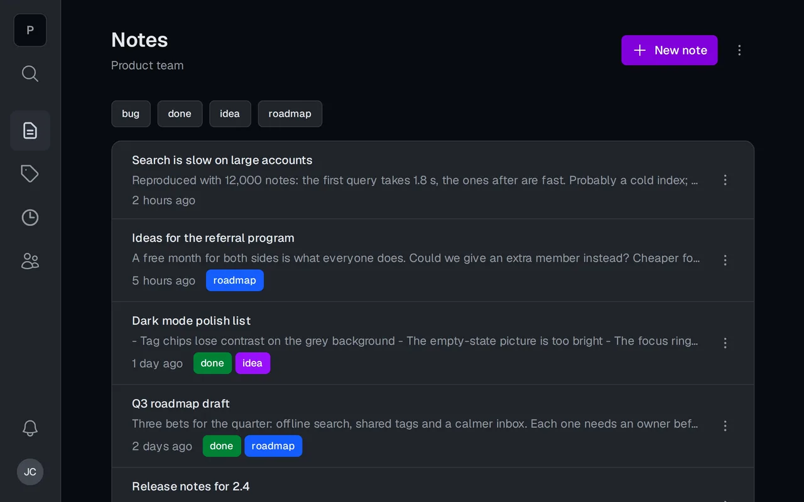
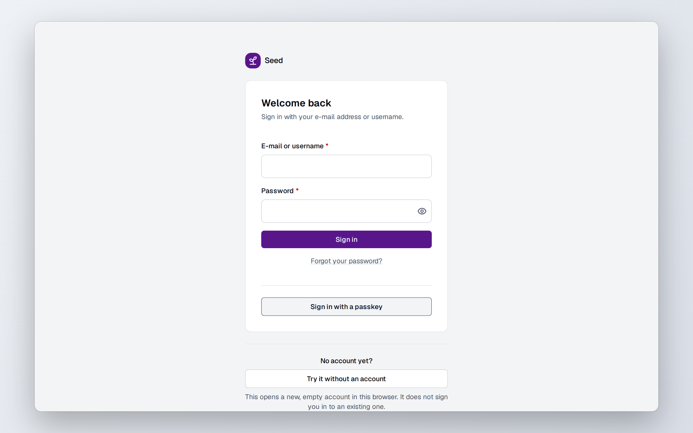
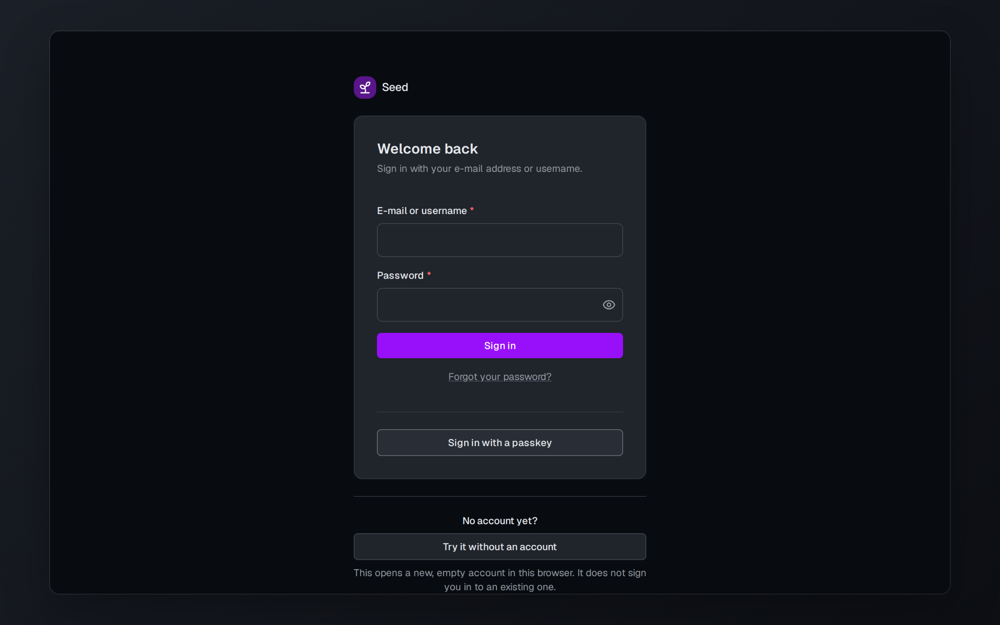
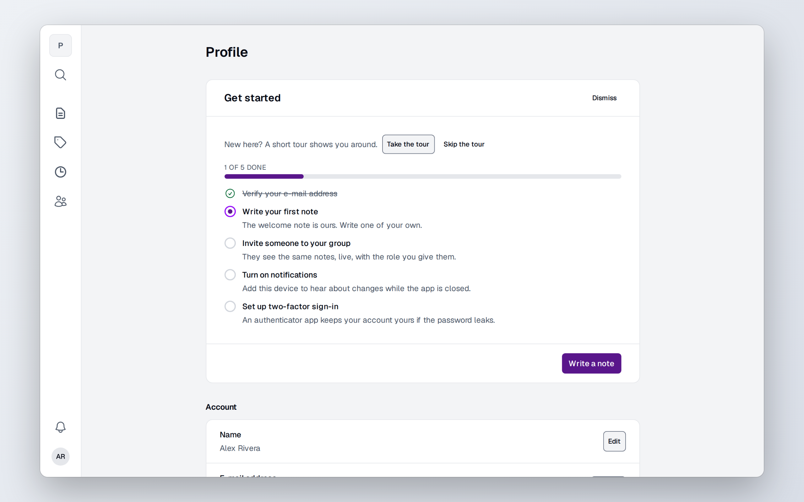
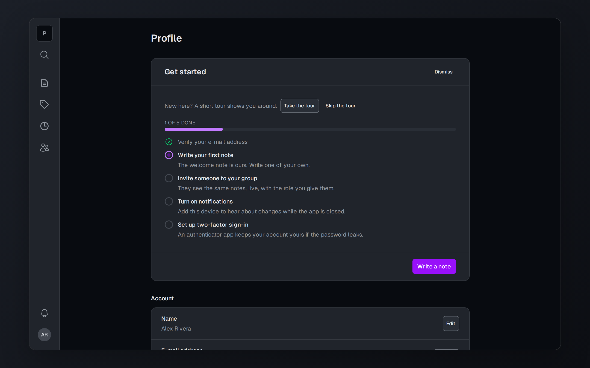
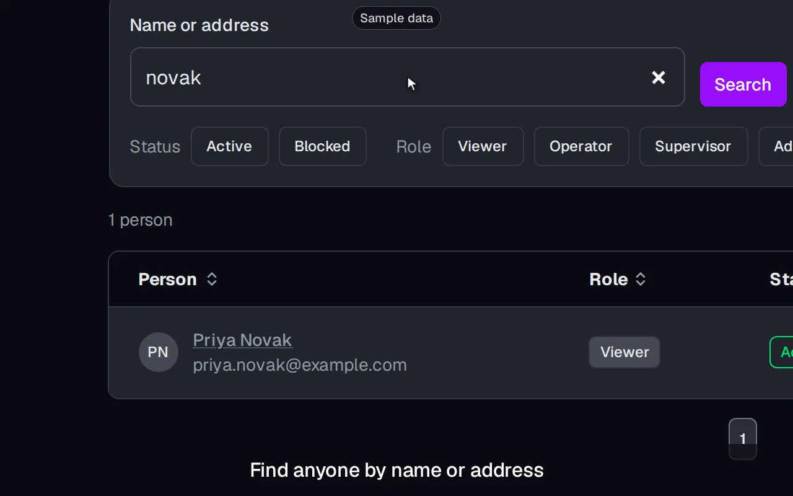

<div align="center">

# Seed

**Seed: the free SaaS starter built on web standards. Runs on Deno, Node and Bun.** The groundwork
of your SaaS, already built: sign-in with a second factor, groups with roles, per-member Stripe
billing, realtime, an offline app and an admin area, on Postgres and Docker Compose. MIT-licensed,
usable today, built in public.

[](https://ci.antonshubin.com/repos/15)
[](LICENSE)

<!-- Seed's own site: see docs/start-a-product.md -->

[**Try the live demo →**](https://app.seedsaas.com) · [Website](https://seedsaas.com) ·
[Architecture](docs/architecture.md) · [Deploy](docs/deploy.md) · [All docs](docs/README.md) ·
[Start a product](docs/start-a-product.md)

<a href="https://antonshubin.com/tools/seed"></a>

</div>

Create your repository from it, fill in the env file, and you start with a product that already
has accounts, a second factor, tenancy and a place for background work. A new user signs up and
gets an account, a session and a first group in one database transaction. Groups are the only
tenancy boundary, so the same membership checks and roles cover a person's own data and
shared workspaces.

It exists because every SaaS MVP needs the same groundwork before its first feature. The reusable
parts live here and in the published [`@spy4x/*`](https://jsr.io/@spy4x) packages; product rules
stay out.

**Status:** usable today, and still growing in public. On `main` now: passkeys, Google and
GitHub sign-in, email sign-in codes, guest accounts, a second factor, groups with roles and invitations,
Stripe billing per member, notes (the reference feature), the file store, notifications in the app,
by web push and in Telegram, nine languages, an offline SPA, the admin panel, and a public website
with a blog and a newsletter. All of it is tested in CI, and most of it runs in the
[live demo](https://app.seedsaas.com) with made-up people. Not built yet: the [Android](https://github.com/spy4x/seed/issues/202) and
[desktop](https://github.com/spy4x/seed/issues/203) apps, and the rest of the
[open issues](https://github.com/spy4x/seed/issues).

## Why Seed

- **Tenancy from day one.** Every user gets a group at sign-up; every group uses the same IDs,
  membership checks and roles, from viewer to owner. A group can be renamed, deleted and, for 30
  days, restored, and a person always keeps at least one.
- **Sign-in that is done.** E-mail and password with a confirmation code, passkeys, Google and
  GitHub, and email sign-in codes. A visitor can start in a guest account with one click and
  add a sign-in method later, keeping their data. An authenticator app adds a second factor,
  people see and end their sessions, and personal API tokens are stored only as hashes.
- **Billing per member, through Stripe.** A free plan with limits, a 14-day trial, quantities that
  follow the member count and a grace period after a failed payment:
  [docs/billing.md](docs/billing.md).
- **Nine languages.** The SPA, the admin panel, the website and the mails speak English, German,
  Spanish, French, Brazilian Portuguese, Russian, Japanese, Simplified Chinese and Arabic, which
  reads right to left.
- **A file store.** Garage, a bundled S3 store, keeps images and PDFs on notes and profile
  pictures. Uploads go through signed links, and photos become small AVIF and WebP copies with
  their metadata removed: [docs/files.md](docs/files.md).
- **Notifications.** In the app, by web push on a phone or desktop, and in Telegram once a person
  links the bot: [docs/telegram.md](docs/telegram.md).
- **Offline-first SPA.** The SPA keeps the last notes and groups in IndexedDB (the shared data
  cache), opens with no network, and queues note writes with their idempotency keys. It sends them
  on reconnect and shows a stale write as a conflict to settle, never as a silent overwrite. The
  layer sits in one folder, so a product that does not want it deletes the folder, follows the
  removal steps in [docs/offline.md](docs/offline.md#removing-the-layer) and keeps an online SPA.
- **An admin panel on its own host.** Operators find a person and see their sign-in methods,
  sessions and groups, refund a payment, write the blog, look after the newsletter's subscribers
  and rerun a failed job. Every action goes to the audit log.
- **A public website.** Server-rendered by a small Fresh-compatible layer built with Vite, and
  usable with JavaScript off: pricing, legal
  pages, a blog with an RSS feed, and a newsletter with double opt-in and one-click unsubscribe:
  [docs/apps.md](docs/apps.md).
- **CQRS with an outbox.** Commands, queries and events go through one bus. Every group change
  writes its event to `outbox_events`, and the worker drains that table.
- **Safe API defaults.** Every mutation must come from the web app's own origin, and group lists
  page with HMAC-signed cursors.
- **Built on web standards.** Hono handlers take a Fetch `Request` and return a `Response`; password
  hashes and cursor signatures use Web Crypto; live updates travel over a standard WebSocket;
  everything is an ES module. The servers run on Deno, Node or Bun in Docker on any Linux host you
  control, and the clients run in any modern browser.
- **Operations included.** Docker Compose for development and single-node production: Traefik,
  Postgres, Valkey, VictoriaMetrics, VictoriaLogs and Grafana.

**Use it if** you are starting a multi-user web product and want auth, tenancy and operations
settled before the first feature. **Skip it if** you deploy to serverless functions rather than a
server you run.

## Runtimes

Seed runs on Deno, Node and Bun. The API, the worker, the migration and the website start
unchanged on each, and CI starts the API, the worker and the website on all three for every pull
request. One line in the env
file picks the runtime of a product's servers ([docs/apps.md](docs/apps.md#runtime)):

```sh
APP_RUNTIME=node   # or bun; deno, empty or no line keeps Deno
```

The code is built on web standards: Fetch `Request` and `Response`, Web Crypto, WebSocket and ES
modules. Seed's own tasks and tests run on Deno 2, which npm or Bun installs for you below. On 9
October 2026 the Deno team [announced](https://deno.com/blog/cloudflare) one more year of support
for the runtime, with monthly bug-fix and security releases, after which it ends its own
development; Deno stays open source. Running on all three runtimes keeps that choice with you. Seed
never used Deno Deploy, so Deploy's shutdown does not affect a Seed product.

## Quick start

Requires Docker and one of Node, Bun or Deno. The services run in Docker; the tasks that set them
up run on Deno, which the first command installs on Node and Bun. The
[GitHub CLI](https://cli.github.com) is optional: GitHub's "Use this template" button and a clone
do the same as the `gh` line.

### Node

```sh
npm install -g deno
gh repo create my-product --template spy4x/seed --private --clone
cd my-product
npm run init
npm run dev
```

### Bun

```sh
bun add -g deno
gh repo create my-product --template spy4x/seed --private --clone
cd my-product
bun run init
bun run dev
```

### Deno

```sh
gh repo create my-product --template spy4x/seed --private --clone
cd my-product
deno task init
deno task dev
```

The root `package.json` hands the common tasks (`init`, `dev`, `test`, `compose` and the others it
lists) to Deno, so the docs' `deno task <name>` also runs as `npm run <name>` or
`bun run <name>`. To run the product's servers on Node or Bun as well, set `APP_RUNTIME=node` or
`APP_RUNTIME=bun` in `infra/envs/.env` before `dev`; to switch later, rebuild the images as
[docs/apps.md](docs/apps.md#runtime) says.

`init` checks that Docker runs, copies `infra/envs/.env.example` to `infra/envs/.env`, generates
every secret and the web push keys, records the Seed commit your copy came from, and asks for the
project name. `dev` starts Traefik, unless one already runs, then
Postgres, Valkey, the API, the worker, the SPA and the monitoring. Then open http://app.localhost.
[Get started](docs/get-started.md) walks through it step by step: what opens where, and what to do
when a step fails.

Or ask your AI agent:

```text
Create my new product "Acme" from https://github.com/spy4x/seed and run it locally
```

To use Podman, set `CONTAINER_PROVIDER=podman` in the env file and start Traefik with
`deno task proxy:start`, which calls Docker.

To keep taking Seed's fixes and features in your product later, see
[docs/products.md](docs/products.md).

The rest of the local stack (monitoring, migrations, demo data, resetting the database) is in
[docs/local-stack.md](docs/local-stack.md).

## What you get

| Light                                                                                                                                                                                                                                                                                                                                                                                                  | Dark                                                                                                                                                                                                                                                                                                                                                                                                 |
| ------------------------------------------------------------------------------------------------------------------------------------------------------------------------------------------------------------------------------------------------------------------------------------------------------------------------------------------------------------------------------------------------------ | ---------------------------------------------------------------------------------------------------------------------------------------------------------------------------------------------------------------------------------------------------------------------------------------------------------------------------------------------------------------------------------------------------- |
|          |          |
|  |  |

The admin panel, on its own host, in a 58-second video on the website:

<a href="https://seedsaas.com/admin"></a>

The screenshots, the GIF and the video show made-up people;
[`docs/screenshots/record.ts`](docs/screenshots/record.ts) records the pictures again from a running
app, and [`docs/screenshots/admin-video.ts`](docs/screenshots/admin-video.ts)
(`deno task video:admin`) the video.

<details>
<summary>How the parts fit together</summary>


</details>

## Documentation

> Also on the website: [seedsaas.com/docs](https://seedsaas.com/docs), every guide below that is
> not internal, with the changelog at [seedsaas.com/changelog](https://seedsaas.com/changelog).

- [The three apps](docs/apps.md): the SPA, the admin app and the public website.
- [Deploy to a server](docs/deploy.md): the first deploy. Then [updates](docs/deploy-updates.md),
  [certificates](docs/certificates.md), [operator access](docs/operator-access.md),
  [several projects](docs/several-projects.md) and [releases](docs/releases.md).
- [Settings](docs/settings.md): every variable of the env file.
- [Guest accounts](docs/guests.md)
- [Sign in with Google and GitHub](docs/sign-in-providers.md)
- [Backups](docs/backups.md): set up, and [restore and rehearse](docs/restore.md).
- [The file store](docs/files.md): Garage or another S3 store, signed uploads and downloads.
- [Every task](docs/development.md) and [the browser tests](docs/browser-tests.md).
- [Add your first feature](docs/first-feature.md), then
  [the aggregate reference](docs/aggregates.md).
- [Everything else](docs/README.md)

## Development

```sh
deno task check           # lint, format check, type check and unit tests
deno task hooks:install   # runs the checks before every commit
deno task e2e:local       # browser tests on a stack of their own
```

See [CONTRIBUTING.md](CONTRIBUTING.md) for the rules and [docs/handoff.md](docs/handoff.md) for the
traps in this codebase.

## Built by

<!-- Seed's own site: see docs/start-a-product.md -->

I'm [Anton Shubin](https://antonshubin.com), a senior full-stack engineer and tech lead.
Seed is the foundation I build client SaaS MVPs on. Need an MVP built for your product?
[That's my day job →](https://antonshubin.com/catalog/zero-to-production-saas-mvp)

Licensed under [MIT](LICENSE). Copyright (c) 2026 Anton Shubin.

---

Made by Anton Shubin · [antonshubin.com/tools/seed](https://antonshubin.com/tools/seed)
