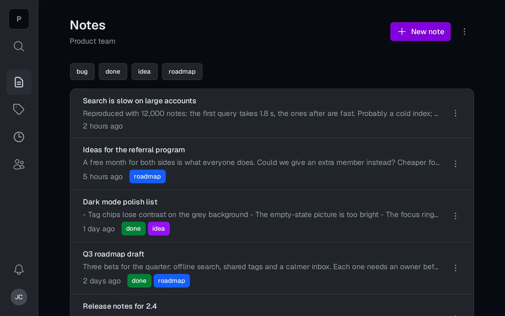
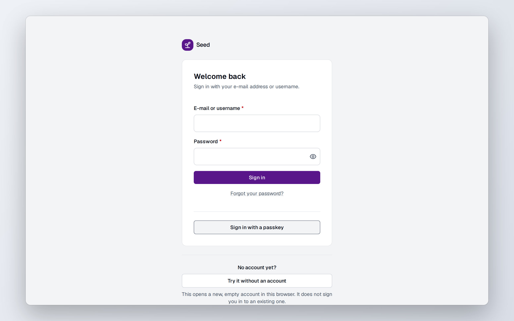
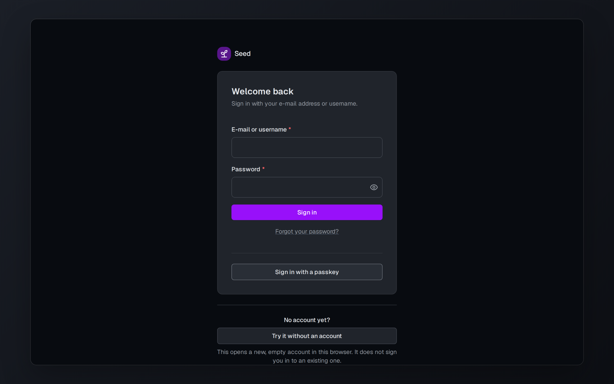
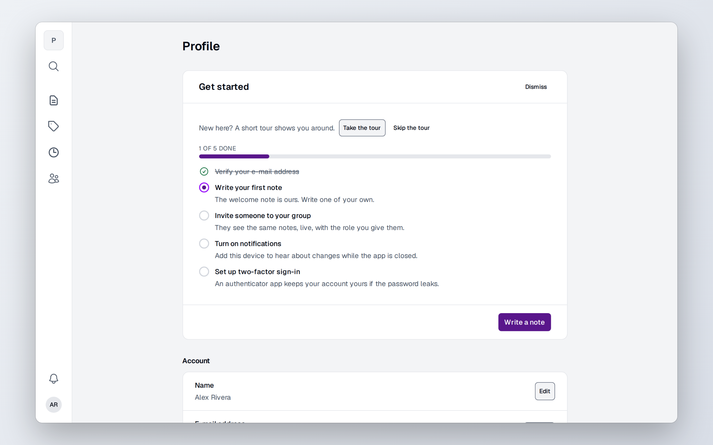
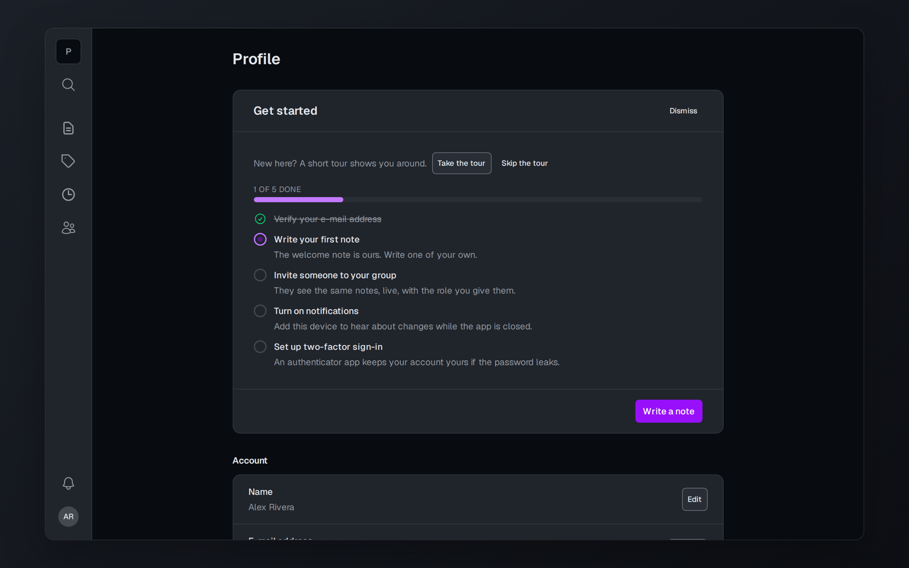
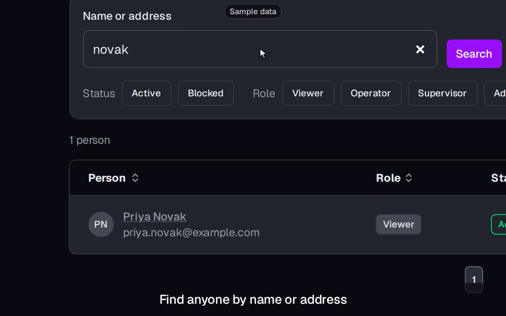

<div align="center">

# Seed

**The groundwork of your SaaS, already built. A free, MIT-licensed starter: sign-in with a second
factor, groups with roles, per-member Stripe billing, realtime, an offline app and an admin area.
Deno, Postgres, Docker Compose. Work in progress.**

[](https://ci.antonshubin.com/repos/15)
[](LICENSE)

<!-- Seed's own site: see docs/start-a-product.md -->

[**Try the live demo →**](https://app.seedsaas.com) · [Website](https://seedsaas.com) ·
[Architecture](docs/architecture.md) · [Deploy](docs/deploy.md) · [All docs](docs/README.md) ·
[Start a product](docs/start-a-product.md)

<a href="https://antonshubin.com/tools/seed"></a>

</div>

Create your repository from it, fill in the env file, and you start with a product that already
has accounts, a second factor, tenancy and a place for background work. A new user signs up and
gets an account, a session and a first group in one database transaction. Groups are the only
tenancy boundary, so the same membership checks and roles cover a person's own data and
shared workspaces.

It exists because every SaaS MVP needs the same groundwork before its first feature. The reusable
parts live here and in the published [`@spy4x/*`](https://jsr.io/@spy4x) packages; product rules
stay out.

**Status:** work in progress. Sign-up, sign-in with TOTP, groups with members, roles, invitations
and ownership transfer, billing per member, notes (the reference aggregate), the outbox worker, the
admin app and the public website work today, and the SPA works offline. What is not built yet is
on the [open issues](https://github.com/spy4x/seed/issues).

## Why Seed

- **Tenancy from day one.** Every user gets a group at sign-up; every group uses the same IDs,
  membership checks and roles, from viewer to owner. A group can be renamed, deleted and, for 30
  days, restored, and a person always keeps at least one.
- **Auth that is done.** Sign-up, sign-in (also by a link sent by e-mail), sessions and an
  authenticator-app second factor, with PBKDF2-SHA-256 password hashes. Web push subscriptions are built in too.
- **Offline-first SPA.** The SPA keeps the last notes and groups in IndexedDB (the shared data
  cache), opens with no network, and queues note writes with their idempotency keys. It sends them
  on reconnect and shows a stale write as a conflict to settle, never as a silent overwrite. The
  layer sits in one folder, so a product that does not want it deletes the folder, follows the
  removal steps in [docs/offline.md](docs/offline.md#removing-the-layer) and keeps an online SPA.
- **Mailing lists.** Visitors subscribe at `/subscribe` with double opt-in, and every list mail
  carries a one-click unsubscribe. The worker signs the links with `SUBSCRIBERS_SECRET` and sends
  the confirm, welcome and issue mail:
  [docs/architecture.md](docs/architecture.md#mail-subscriptions).
- **CQRS with an outbox.** Commands, queries and events go through one bus. Every group change
  writes its event to `outbox_events`, and the worker drains that table.
- **Safe API defaults.** Every mutation must come from the web app's own origin, and group lists
  page with HMAC-signed cursors.
- **Built on web standards.** Hono handlers take a Fetch `Request` and return a `Response`;
  password hashes and cursor signatures use Web Crypto; live updates travel over a standard
  WebSocket; everything is an ES module. The servers run on Deno 2 in Docker on any Linux host you
  control, and the clients run in any modern browser.
- **Operations included.** Docker Compose for development and single-node production: Traefik,
  Postgres, Valkey, VictoriaMetrics, VictoriaLogs and Grafana.

**Use it if** you are starting a multi-user web product and want auth, tenancy and operations
settled before the first feature. **Skip it if** you deploy to serverless functions rather than a
server you run.

## Quick start

Requires [Deno](https://deno.com) 2 and Docker. The services run in Docker; the tasks that set
them up run on Deno. The [GitHub CLI](https://cli.github.com) is optional: GitHub's "Use this
template" button and a clone do the same as the first line.

```sh
gh repo create my-product --template spy4x/seed --private --clone
cd my-product
deno task init
deno task dev
```

`init` copies `infra/envs/.env.example` to `infra/envs/.env`, generates every secret and the web
push keys, and asks for the project name. `dev` starts Traefik, unless one already runs, then
Postgres, Valkey, the API, the worker, the SPA and the monitoring. Then open http://app.localhost.

Or ask your AI agent:

```text
Create my new product "Acme" from https://github.com/spy4x/seed and run it locally
```

To use Podman, set `CONTAINER_PROVIDER=podman` in the env file and start Traefik with
`deno task proxy:start`, which calls Docker.

To keep taking Seed's fixes and features in your product later, see
[docs/products.md](docs/products.md).

The rest of the local stack (monitoring, migrations, demo data, resetting the database) is in
[docs/development.md](docs/development.md).

## What you get

| Light                                                                                                                                                                                                                                                                                                                                                                                                  | Dark                                                                                                                                                                                                                                                                                                                                                                                                 |
| ------------------------------------------------------------------------------------------------------------------------------------------------------------------------------------------------------------------------------------------------------------------------------------------------------------------------------------------------------------------------------------------------------ | ---------------------------------------------------------------------------------------------------------------------------------------------------------------------------------------------------------------------------------------------------------------------------------------------------------------------------------------------------------------------------------------------------- |
|          |          |
|  |  |

The admin panel, on its own host, in a 58-second video on the website:

<a href="https://seedsaas.com/admin"></a>

The screenshots, the GIF and the video show made-up people;
[`docs/screenshots/record.ts`](docs/screenshots/record.ts) records the pictures again from a running
app, and [`docs/screenshots/admin-video.ts`](docs/screenshots/admin-video.ts)
(`deno task video:admin`) the video.

<details>
<summary>How the parts fit together</summary>


</details>

## Documentation

- [The three apps](docs/apps.md): the SPA, the admin app and the public website.
- [Deploy and operate](docs/deploy.md): certificates, the deploy, consoles, several projects on one
  server, releases.
- [Guest accounts](docs/guests.md)
- [Sign in with Google and GitHub](docs/sign-in-providers.md)
- [Backups](docs/backups.md): set up, restore, rehearse.
- [The file store](docs/files.md): Garage or another S3 store, signed uploads and downloads.
- [Development](docs/development.md): every task and the browser tests.
- [Adding a feature](docs/aggregates.md): every file of the notes aggregate, in order.
- [Everything else](docs/README.md)

## Development

```sh
deno task check           # lint, format check, type check and unit tests
deno task hooks:install   # runs the checks before every commit
deno task e2e:local       # browser tests on a stack of their own
```

See [CONTRIBUTING.md](CONTRIBUTING.md) for the rules and [docs/handoff.md](docs/handoff.md) for the
traps in this codebase.

## Built by

<!-- Seed's own site: see docs/start-a-product.md -->

I'm [Anton Shubin](https://antonshubin.com), a senior full-stack engineer and tech lead.
Seed is the foundation I build client SaaS MVPs on. Need an MVP built for your product?
[That's my day job →](https://antonshubin.com/catalog/zero-to-production-saas-mvp)

Licensed under [MIT](LICENSE). Copyright (c) 2026 Anton Shubin.

---

Made by Anton Shubin · [antonshubin.com/tools/seed](https://antonshubin.com/tools/seed)
