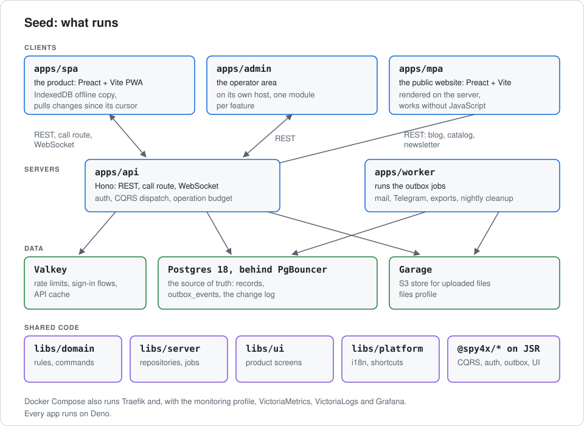

# Architecture

This page shows how Seed's apps, libraries and services fit together, and what each one owns.

You need:

- Nothing installed. [ADR 001](decisions/001-deno-platform-template.md) and
  [ADR 002](decisions/002-realtime-transport-and-sync.md) hold the decisions; this page sums them
  up.

## The apps

| App           | What it is                                                                         |
| ------------- | ---------------------------------------------------------------------------------- |
| `apps/spa`    | The product, a Preact and Vite PWA. It keeps an offline copy in IndexedDB          |
| `apps/admin`  | The operator area, on a host of its own ([Admin modules](admin-modules.md))        |
| `apps/mpa`    | The public website. It renders on the server and works without JavaScript          |
| `apps/api`    | Hono: REST, the call route, the WebSocket, auth and CQRS dispatch                  |
| `apps/worker` | Runs the outbox jobs: mail, Telegram notices, data exports and the nightly cleanup |

The MPA has no session. It reads the API for the blog, contact links, the catalog and the
newsletter. [Seed's apps](apps.md) says which a product keeps.

## The data

Postgres 18 is the source of truth; the apps reach it through PgBouncer. A browser's data is a
local copy in IndexedDB, filled by a pull of what changed since its cursor
([offline.md](offline.md)).

A write runs as one command in one transaction. It records the change and any job in
`outbox_events`, so the worker and the other open sockets learn of it from the same row. Every
write is versioned and idempotent ([ADR 002](decisions/002-realtime-transport-and-sync.md)).

| Service  | What it holds                                                                        |
| -------- | ------------------------------------------------------------------------------------ |
| Postgres | Every record, the outbox and the change log                                          |
| Valkey   | Rate limits, passkey and sign-in-provider flows, the operation budget, the API cache |
| Garage   | Uploaded files, an S3 store, with the `files` profile                                |

A migration only adds. One that rewrites rows is idempotent and safe to rerun during a rollout.

## The libraries

| Library       | What it holds                                                          |
| ------------- | ---------------------------------------------------------------------- |
| `libs/domain` | Business rules, commands, events and queries, one package per aggregate |
| `libs/server` | Postgres repositories, jobs, mail and other server adapters           |
| `libs/ui`     | The product's screens: props in, callbacks out                        |
| `libs/platform` | The translation and keyboard shortcut helpers the apps share        |

Generic code comes from the `@spy4x/*` packages on JSR, pinned to an exact version. Generic UI is
`@spy4x/preact-*`.

Every group, including the one made at sign-up, uses one authorization and sync model.

## Mail subscriptions

Visitors join a mailing list through `@spy4x/server/subscribers`. Seed ships one list, `news`. A
product adds more in `SUBSCRIBER_LISTS` (`libs/domain/subscribers`), with no schema change.

The API writes a `subscription_requests` row and an outbox job. Only the worker signs links and
sends mail, as with a password reset.

| Job                        | Queued by                                         | The worker                                          |
| -------------------------- | ------------------------------------------------- | --------------------------------------------------- |
| `subscribers.confirm-mail` | `POST /api/subscribers`, alike for any address    | Signs the confirm token, sends, deletes the request |
| `subscribers.welcome-mail` | A successful confirm                              | Sends the welcome, if the address is still listed   |
| `subscribers.send-issue`   | `deno task subscribers:send <list> <issue.json>`  | Sends the issue; a retry mails only who missed it   |

| Setting                        | What it does                                                    |
| ------------------------------ | --------------------------------------------------------------- |
| `SUBSCRIBERS_SECRET`           | Signs every link. At least 32 printable characters              |
| `SUBSCRIBERS_PREVIOUS_SECRETS` | Comma-separated, optional. Still verifies links from before a rotation |

The secret, and every previous one, must differ from `AUTH_COOKIE_SECRET`. So rotating cookies
keeps every sent unsubscribe link working. Each list signs with its own key, derived from the
secret. Make one with `openssl rand -base64 48`.

Production refuses the public development secret. Without a secret there, the routes answer 503
and the worker drops subscriber jobs.

- **Pages.** `/subscribe`, `/subscribe/confirm` and `/unsubscribe` exist in the SPA and the MPA.
  Token pages answer `Cache-Control: no-store` and send no `Referer`. A finished step leaves the
  token out of the address.
- **One-click unsubscribe.** `POST /api/subscribers/unsubscribe` is the RFC 8058 target. A mail
  client's post passes, and a cross-site browser post gets 403. It accepts only the version 2
  tokens Seed signs.
- **Rate limits.** Per address on subscribing and on every token check, and three confirm mails an
  hour per e-mail address. Valkey keys the budget by an HMAC, so it holds no address.
- **Cleanup.** The nightly cleanup removes requests older than a day.

**Issues.** `subscribers:send` runs in the worker container and reads `{ id, subject, preheader?,
blocks }`. Each block is a `heading`, a `paragraph`, a `list` or a `button`. Rerunning the same
`id` mails only who has not got it. In development the mail lands in `dev_mail`, without the
`List-Unsubscribe` header.

## Operation budget

Every operation spends one unit of its caller's budget before it runs
(`apps/api/middlewares/operation-rate-limits.ts`). That covers `POST /api/call/<name>`, the socket
and every signed-in REST write. Without it, anyone could fill the disk with notes in a loop, since
plan caps are lifted when billing is off.

The REST writes left out are those under `/api/auth`, `/api/admin` and `/api/call`, which is
already counted. REST reads are not budgeted. The budget lives in Valkey, so it holds across API
processes.

| Who                        | Counted by                          | Commands a minute | Queries a minute |
| -------------------------- | ----------------------------------- | ----------------- | ---------------- |
| A signed-in person         | User id, every device together      | 120               | 600              |
| Every guest on an address  | Client address (IPv6: its /48)      | 60                | 300              |

| Setting                               | Default |
| ------------------------------------- | ------- |
| `OPERATION_COMMANDS_PER_MINUTE`       | 120     |
| `OPERATION_QUERIES_PER_MINUTE`        | 600     |
| `GUEST_OPERATION_COMMANDS_PER_MINUTE` | 60      |
| `GUEST_OPERATION_QUERIES_PER_MINUTE`  | 300     |

- **Guests by address.** A guest account costs a click, so more guest accounts give no more
  writes. The address is read as the guest-start limit reads it (`signUpClient`). Behind
  Cloudflare's proxy, every guest through one Cloudflare edge shares one budget.
- **The refusal.** A call past the budget gets `rate_limited` (429), "Too many requests. Wait a
  minute", and its handler does not run. A refused REST write also carries `Retry-After`. The SPA's
  offline queue keeps the write and sends it again later.
- **Store outage.** When Valkey cannot be reached, calls pass and the failure is logged.

## Next

- [Seed's apps](apps.md)
- [Offline](offline.md)
- [ADR 002: realtime transport and sync](decisions/002-realtime-transport-and-sync.md)
